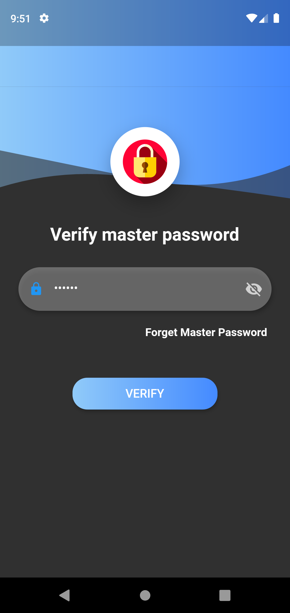
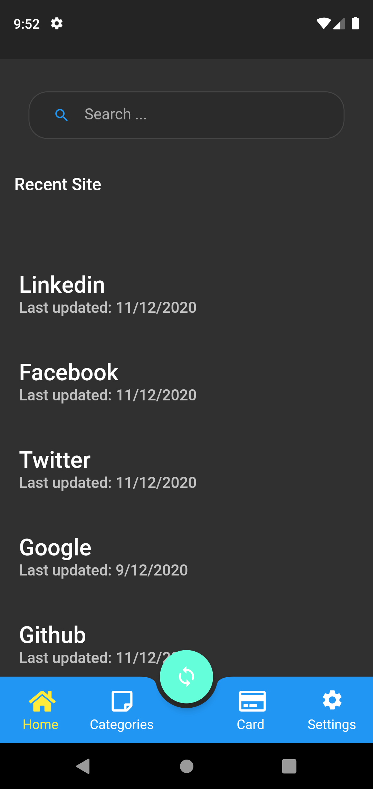
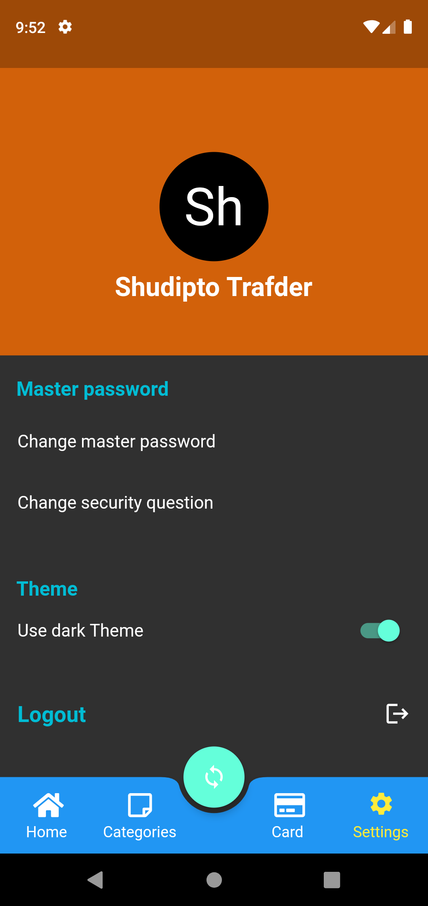
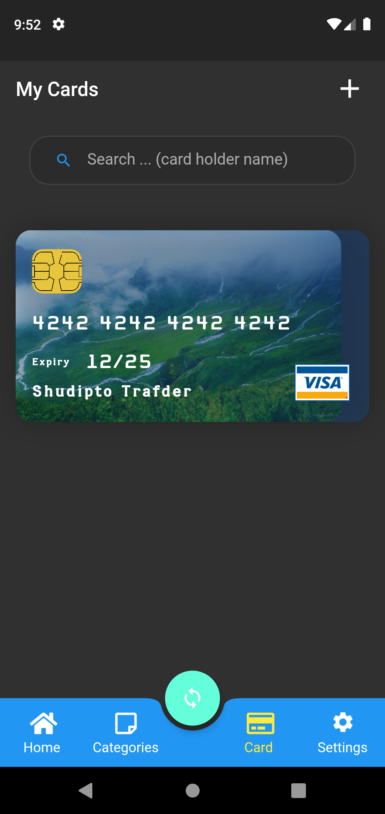
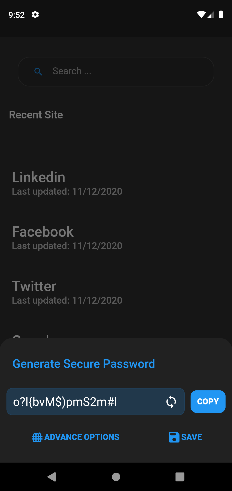
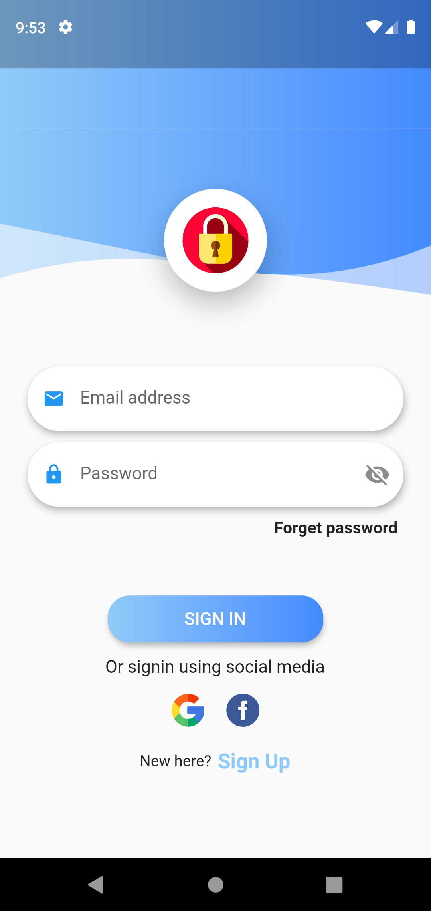
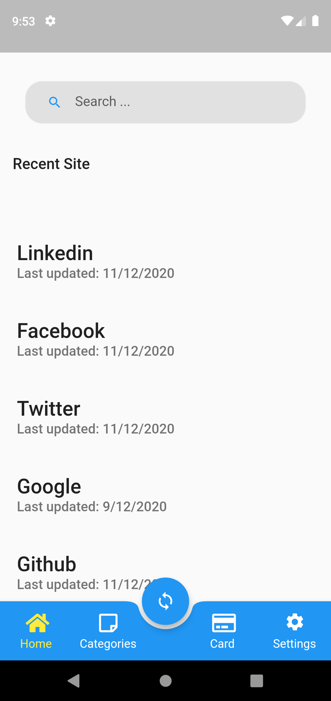
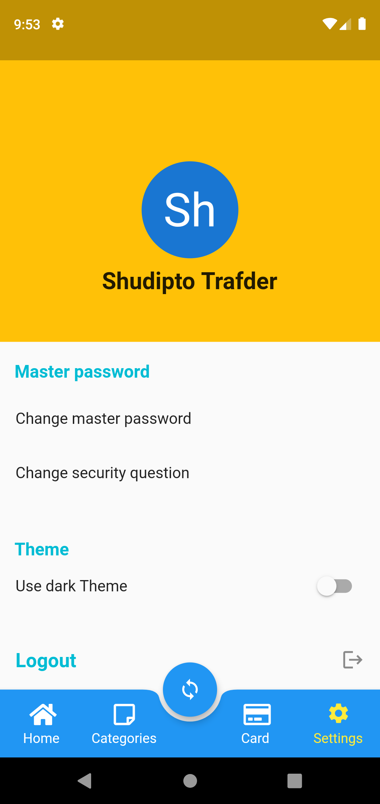
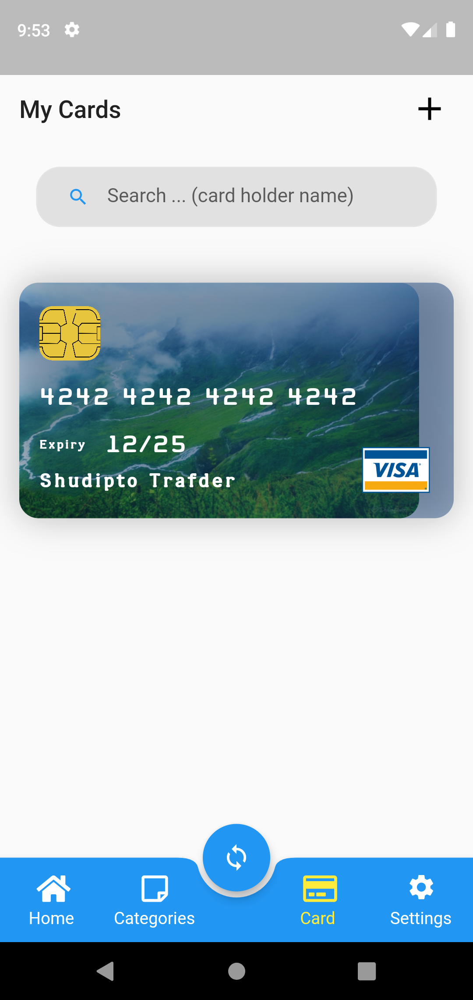
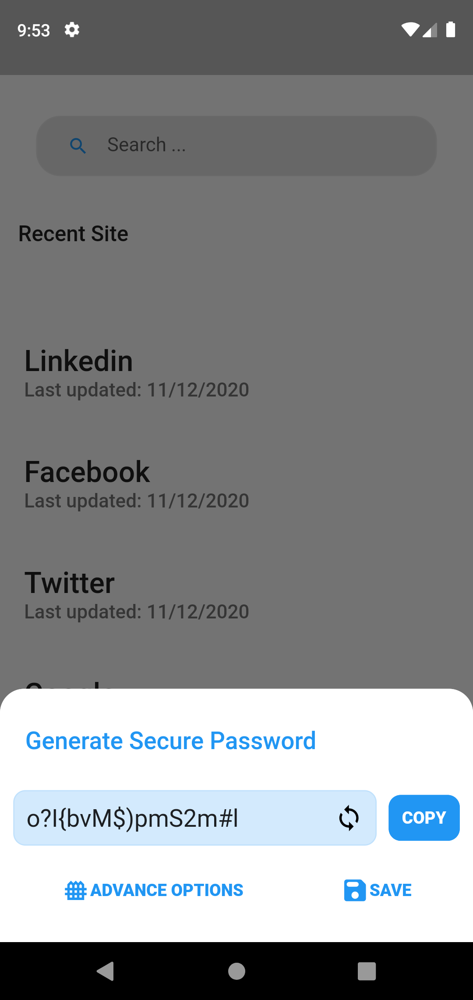

# Password Manager

A personal, self-built password manager for mobile — open source, built with Flutter.

This is **not** a published app you download from a store, and it is not a service you sign up
for. It is a template you build **for yourself**: you point it at your own Firebase project,
set your own encryption key, and compile your own private APK. Nobody else installs it, and
nobody else's data ever touches it.

### Motivation

I wanted a password manager that I fully own — no vendor, no shared backend, no trust required.
So this project is designed to be *forked and personalized*. All of your passwords are stored
encrypted in **your own Firebase Firestore** database, under **your own** Google account.

Two steps to have your own build:

1. Create a **Firebase** project and enable **Cloud Firestore**
2. Build the **app** with Flutter

### Screenshots

**(Dark)**

|MasterPass Verify UI|   Home UI   |   Profile UI   |   Card UI   |   Password Gen UI   |
| ---- | ---- | ---- | ---- | ---- |
|      |      |      |      |      |

**(Light)**

| Login UI                    | Home Page UI               | Profile UI                   | Credit Card UI              | Password Gen UI             |
| --------------------------- | -------------------------- | ---------------------------- | --------------------------- | --------------------------- |
|  |  |  |  |  |

## How can I create my own version?

1. Install and configure Flutter on your computer

2. Create a Firebase account and a Firebase project

3. Enable Cloud Firestore for that project

4. Download `google-services.json` from your Firebase project and put it in **android/app/**

5. Create your `.env` file at the project root by copying the template:

   ```
   cp .env.example .env
   ```

   Then set your own encryption key in it:

   ```
   PASS=<your own 16-character secret>
   ```

   This value is **your** AES key. It is read at app startup and used to encrypt and decrypt
   every entry before it is written to Firestore, so your data is unreadable in the database
   itself. It must be **exactly 16 characters** — the `encrypt` package derives the AES key
   directly from these bytes.

   It is *not* a login password and *not* a hash of anything. You never type it into the app;
   it is compiled into your personal build. The master password you type on the verify screen
   is a separate thing, set up inside the app.

6. Build your **Android APK**:

   ```
   flutter build apk
   ```

   Install that APK on your own phone. That's your version of the app.

### Keep your build private

Only `.env.example` is tracked in this repository. Your real `.env` is git-ignored, so your key
stays on your machine and never reaches a fork. Treat the rest of your build as private too:

- Never commit your real `PASS` value, and don't share it.
- Don't distribute the APK you built — it carries your key inside it.
- `google-services.json` is git-ignored as well; it belongs to your Firebase project only.
- If you change `PASS` after you have saved entries, previously stored entries can no longer be
  decrypted. Pick it once, and keep a copy somewhere safe (offline).

Because each person builds their own copy with their own key and their own Firebase project,
there is no shared build and no common key across users. That is the whole point of the design.

### Disclaimer: this project has not been tested on iOS.

## Flutter Architecture

### Encryption

- AES (CTR / SIC mode) from the `encrypt` package, keyed by your `PASS` value

##### 3rd party libraries

| GetX                      | Font Awesome Flutter | Google fonts     | Cloud Firestore |
| :------------------------ | -------------------- | ---------------- | --------------- |
| Injectable + GetX + GetIt | Flutter Svg          | Get Storage      | Firebase auth   |
| Encrypt                   | Flutter Fimber       | Flutter Slidable | Firebase auth   |
| Flutter Dotenv            | Flutter credit card  | uuid             | Google sign in  |

## Issues

Feel free to submit issues and enhancement requests.

## Contributing

Pull requests are welcome.

## Copyright and Licensing

This project is licensed under the [Apache 2.0 license](http://www.apache.org/licenses/LICENSE-2.0)
